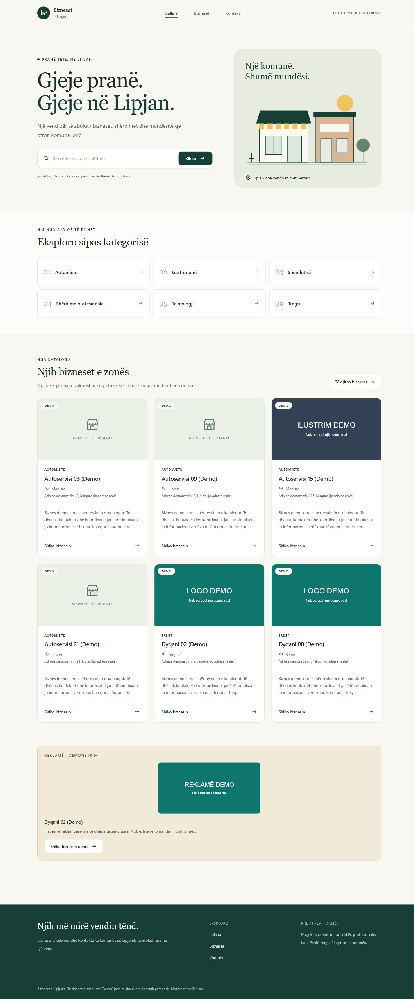

# Katalogu i bizneseve të komunës së Lipjanit

Projekt i praktikës profesionale për të kërkuar biznese, për të parë shërbimet dhe vendndodhjen e tyre dhe për t'i kontaktuar. Platforma është projekt studentor, jo regjistër zyrtar i komunës.

## Gjendja aktuale

Ballina publike dhe katalogu funksionojnë me React/JSX, Tailwind dhe Laravel 12. Ballina ngarkon kategoritë dhe bizneset nga API-ja; `/bizneset` mbështet kërkimin, kategorinë, vendbanimin, shërbimin, website-in, orarin e publikuar, renditjen dhe faqëzimin me 12 biznese. Zgjedhjet ruhen në URL dhe rikthehen pas rifreskimit. Reklamat shënohen veçmas dhe të dhënat demo identifikohen qartë.

Kartat hapin profile të plota në `/bizneset/{slug}`: përshkrim, shërbime, orar, imazhe, kontakte dhe hartë interaktive Leaflet. Harta e katalogut tregon vetëm bizneset e faqes aktuale. Hyrja e administratorit dhe paneli me statistika reale janë në `/admin/login` dhe `/admin/dashboard`. Në `/admin/businesses`, administratori mund të kërkojë, filtrojë, shtojë, ndryshojë, publikojë dhe arkivojë biznese. Faqja `/kontakt` nuk shpik kontakte; duhet konfiguruar një kontakt real para dorëzimit. Shihni [API-në](docs/public-api.md) dhe [verifikimin](docs/acceptance-tests.md).



## Teknologjitë dhe kërkesat

- PHP 8.2+ me PDO MySQL, mbstring, XML, cURL, OpenSSL, fileinfo dhe ZIP; Composer 2
- Laravel 12 dhe Sanctum 4
- MySQL 8 me `utf8mb4` si bazë e synuar
- Node.js 22.12+ dhe npm
- React 19, JavaScript/JSX, Vite 7 dhe Tailwind CSS 4
- Leaflet për hartat, në fazën përkatëse

Në kompjuterin lokal u gjet XAMPP me **MariaDB 10.4.32**, jo MySQL 8. Migrimet dhe lidhja u verifikuan me këtë server përmes driver-it `mysql`. Verifikimi në MySQL 8 mbetet për t'u bërë. Versionet e sakta të paketave ruhen në `backend/composer.lock` dhe `frontend/package-lock.json`.

## Instalimi

Dosja e projektit në këtë kompjuter është `C:\Users\ET\Documents\praktika-p1-thaqi`. Komandat më poshtë nisen nga kjo dosje; nuk nevojitet projekt ose repository i ri.

```powershell
cd backend
composer install
Copy-Item .env.example .env
php artisan key:generate
```

`Copy-Item` përdoret vetëm gjatë instalimit të parë. Në këtë kompjuter `.env` tashmë është krijuar dhe përmban çelësin dhe kredencialet lokale; mos e mbishkruani.

Krijoni bazën dhe një përdorues të veçantë nga një lidhje administrative MySQL. Zëvendësoni fjalëkalimin shembull me një fjalëkalim tuajin:

```sql
CREATE DATABASE lipjan_directory CHARACTER SET utf8mb4 COLLATE utf8mb4_unicode_ci;
CREATE USER 'lipjan_app'@'127.0.0.1' IDENTIFIED BY 'vendosni-nje-fjalekalim-tuajin';
GRANT ALL PRIVILEGES ON lipjan_directory.* TO 'lipjan_app'@'127.0.0.1';
```

Baza dhe përdoruesi janë krijuar tashmë në këtë kompjuter. `.env` përdor `DB_CONNECTION=mysql`, hostin `127.0.0.1`, portën `3306`, bazën `lipjan_directory` dhe përdoruesin `lipjan_app`. Vendosni fjalëkalimin vetëm te `DB_PASSWORD` në `.env`. React nuk merr kredenciale të bazës. Pas ndryshimit të konfigurimit përdorni `php artisan config:clear` dhe rinisni backend-in.

```powershell
# Nga backend/
php artisan migrate
php artisan storage:link
php artisan serve --host=127.0.0.1 --port=8000
```

Migrimet ruajnë tabelat e Laravel/Sanctum dhe shtojnë `categories`, `settlements`, `services`, `businesses`, `business_service`, `business_hours`, `business_images` dhe `advertisements`.

Për të mbushur bazën me të dhëna demonstrimi, nga `backend/`:

```powershell
php artisan db:seed
```

Krijohen 30 biznese demo (26 të publikuara, 2 drafte, 2 të arkivuara), 6 kategori, 4 vendbanime, 10 shërbime, 85 lidhje biznes-shërbim, 140 rreshta orari, 21 imazhe dhe 6 reklama. Reklamat përfshijnë 3 aktuale, 1 të planifikuar, 1 të skaduar dhe 1 të çaktivizuar. Datat llogariten në UTC nga koha e ekzekutimit; `is_active` është çelësi i aktivizimit, ndërsa scope `active()` kontrollon edhe datat dhe biznesin e publikuar.

Seeders mund të ekzekutohen përsëri pa dyfishuar rekordet ose ndryshuar ID-të. Ata rifreskojnë bizneset demo dhe afatet e reklamave demo, prandaj nuk duhen përdorur për të ruajtur ndryshime manuale mbi këto rekorde. Përdoruesit dhe bizneset jashtë grupit demo ruhen. `DatabaseSeeder` i ekzekuton të tre seeders brenda një transaksioni; një konflikt me një slug ekzistues jashtë grupit demo ndërpret transaksionin.

Bizneset kanë `is_demo=true` dhe emra me shenjën “(Demo)”. Kontaktet, adresat, koordinatat dhe ilustrimet janë të simuluara. `location_verified=false`; asnjë pin nuk paraqitet si i verifikuar. Domenet përdorin `example.com`. Ilustrimet SVG janë krijuar për këtë projekt dhe shënohen “DEMO”; gjenden te `backend/public/demo/`.

Drafteve mund t'u mungojnë të dhëna. Kategoritë dhe vendbanimet nuk fshihen kur përdoren nga biznese; shërbimet duhen shkëputur përpara fshirjes. Paneli administrues përdor arkivimin, jo fshirjen fizike: rreshti ruhet, por nuk shfaqet publikisht dhe reklamat e lidhura nuk janë më aktive. Për bizneset reale, administratori konfirmon përputhjen e koordinatave me adresën para publikimit. Bizneset demo mbeten të shënuara si të simuluara.

Orari përdor ditët `0` (e diel) deri `6` (e shtunë), me një interval për ditë. Mungesa e rreshtave do të thotë orar i papublikuar. Ditët e mbyllura kanë të dy orët `null`; ora e mbylljes më e vogël se ajo e hapjes nënkupton ditën pasuese. Kufizimet e koordinatave, ditëve/orëve dhe intervalit të reklamës aplikohen në MariaDB/MySQL. SQLite përdoret për kontrolle të shpejta, pa këto CHECK shtesë. Për MySQL kërkohet 8.0.16+ për zbatimin e [CHECK constraints](https://dev.mysql.com/doc/refman/8.0/en/create-table-check-constraints.html); MySQL 8 nuk është testuar ende.

Në një terminal tjetër, nga rrënja e projektit:

```powershell
cd frontend
npm ci
npm run dev
```

Hapni [frontend-in lokal](http://127.0.0.1:5173). Përdorni vazhdimisht `127.0.0.1` gjatë zhvillimit. Vite mban portën `5173` dhe përcjell `/api`, `/sanctum`, `/demo` dhe `/storage` te Laravel në portën `8000`. Kjo mban kërkesat në të njëjtën origjinë nga këndvështrimi i shfletuesit. Në prodhim këto rrugë duhen përcjellë te Laravel nga web server-i; `vite preview` shërben vetëm skedarët statikë.

## Kontrollet

Në prodhim, web server-i duhet të shërbejë `frontend/dist/index.html` për rrugët publike `/`, `/bizneset`, `/bizneset/{slug}` dhe `/kontakt`, duke ruajtur query parameters. `/api`, `/sanctum`, `/demo` dhe `/storage` duhet të shkojnë te Laravel. Kjo lejon hapjen dhe rifreskimin e URL-ve të ndara; nuk është konfiguruar ose kryer deploy në këtë fazë.

```powershell
# Nga backend/
php artisan test
php vendor/bin/pint --test
composer validate --strict
composer check-platform-reqs
php artisan migrate:status

# Nga frontend/
npm test
npm run build
```

Komanda e zakonshme e testeve përdor SQLite në memorie dhe nuk ndryshon bazën lokale. Testi i endpoint-it mbulon lidhjen funksionale dhe përgjigjen `503` pa detaje private kur baza nuk është e arritshme.

Për testet MariaDB/MySQL, krijoni veçmas `lipjan_directory_test` me `utf8mb4_unicode_ci` dhe jepini përdoruesit lokal të aplikacionit leje mbi atë bazë shtesë. Kopjoni `.env` në `.env.testing`, vendosni `APP_ENV=testing` dhe `DB_DATABASE=lipjan_directory_test`, pastaj ekzekutoni:

```powershell
php vendor/bin/phpunit --configuration phpunit.mysql.xml
```

Në këtë kompjuter konfigurimi është bërë tashmë. `.env.testing` përjashtohet nga Git. Suite-a MariaDB rindërton vetëm bazën e testeve; mbrojtja te `tests/TestCase.php` e refuzon një lidhje MySQL që përdor emër tjetër baze. Mos përdorni bazën e zhvillimit për testet me `RefreshDatabase`. PHPUnit thirret drejtpërdrejt këtu, që konfigurimi alternativ të mos dyfishohet nga komanda Artisan.

Më 20 tetor 2026 kaluan 39 teste me 109 assertions në MariaDB 10.4.32. Në SQLite kaluan 25 teste me 95 assertions dhe u anashkaluan 14 kontrolle specifike për MySQL/MariaDB. U verifikuan edhe rollback/riekzekutimi i 8 migrimeve të reja në bazën e testeve dhe seed-imi i përsëritur në bazën lokale. Këto nuk janë kalim i skenarëve fund-më-fund T-01–T-14.

Për të provuar lidhjen reale përmes Vite me të dy serverët aktivë:

```powershell
Invoke-RestMethod http://127.0.0.1:5173/api/health
```

Përgjigjja e pritur është `status: ok`, `database: connected`. Në shfletues, ballina dhe katalogu duhet të shfaqin rekordet e publikuara nga baza. Nëse backend-i ndalet, shfaqet gabimi dhe butoni “Provo përsëri”; pas rinisjes, butoni duhet t’i rikthejë rekordet.

Më 19 tetor 2026 kaluan: 3 teste backend me 7 assertions, kontrolli i formatimit, validimi i Composer dhe kërkesave PHP, build-i React dhe migrimet në MariaDB lokale. U verifikuan edhe kërkesa direkte, proxy dhe gjendjet e suksesit/gabimit/riprovimit në shfletues.

## Nisja lokale e bazës

XAMPP mund të niset nga paneli i tij. Gjatë konfigurimit lokal, serveri dështoi nga mungesa e memories së alokueshme në Windows (gabimi 1455). U nis me kufij më të vegjël vetëm për atë proces, pa ndryshuar konfigurimin global dhe pa fshirë ose riparuar manualisht të dhëna ekzistuese:

```powershell
& C:\xampp\mysql\bin\mysqld.exe --defaults-file=C:\xampp\mysql\bin\my.ini --standalone --bind-address=127.0.0.1 --innodb-buffer-pool-size=8M --innodb-log-buffer-size=1M --aria-pagecache-buffer-size=8M --key-buffer-size=4M --max-connections=20
```

Përdoreni vetëm kur serveri nuk është tashmë aktiv. Këto janë vlera për verifikim lokal me ngarkesë të vogël; nuk janë konfigurim prodhimi.

## Plani dhe Git

Shihni [planin](docs/development-plan.md) dhe [skenarët e pranimit](docs/acceptance-tests.md). Më 22 tetor kaluan T-01–T-05 dhe T-07; profilet/hartat, administrimi dhe kufiri i skadimit të reklamave në shfletues mbeten në pritje. Në MariaDB kaluan 66 teste/331 assertions; në SQLite 52/317 dhe 14 kontrolle u anashkaluan. Shtatë teste frontend dhe build-i i prodhimit kaluan. Shihni edhe [pamjen në telefon](docs/screenshots/directory-mobile.png).

Punohet në feature branches me commits që përfaqësojnë ndryshime reale. Bashkimi në `main` bëhet përmes Pull Request pasi të kalojnë kontrollet. Repository në GitHub: [XtremeThaqi/praktika-p1-thaqi](https://github.com/XtremeThaqi/praktika-p1-thaqi). Remote `origin` përdor `https://github.com/XtremeThaqi/praktika-p1-thaqi.git`. `.env`, varësitë dhe build-et përjashtohen nga Git.

## Profilet dhe hartat — 23 tetor 2026

Leaflet instalohet me `npm ci`; nuk kërkohet çelës API për hartën bazë OpenStreetMap. Atributimi ruhet. Koordinatat demo janë të simuluara dhe etiketohen; pa koordinata të vlefshme nuk vendoset pin. Nëse pllakat e hartës dështojnë, shfaqet mesazh dhe mundësi riprovimi, ndërsa adresa/kontaktet mbeten të përdorshme. Telefoni, email-i dhe linket e jashtme përdorin vetëm vlerat e ruajtura; mungesat nuk plotësohen me shembuj.

Kaluan 12 teste frontend, 66 teste MariaDB/331 assertions dhe 52 teste SQLite/317 assertions (14 kontrolle specifike u anashkaluan). T-14 u verifikua në shfletues; T-06 mbetet në pritje të provës përfundimtare të kontaktit në pajisje të përshtatshme. Nuk u kryen telefonata ose dërgime email-esh gjatë testeve. Shihni [profilin me hartë](docs/screenshots/profile-map-desktop.png) dhe [profilin në telefon](docs/screenshots/profile-mobile.png).

Commit-et e ardhshme përdorin mesazhe të shkurtra e natyrale në anglisht, pa prefikse Conventional Commits. Historia e mëparshme ruhet.

## Administrimi — 24 tetor 2026

Pas migrimeve, krijoni administratorin e parë lokalisht nga `backend/`:

```powershell
php artisan migrate
php artisan admin:create
```

Komanda kërkon emrin, emailin dhe një fjalëkalim të paktën 12 karaktere me konfirmim. Fjalëkalimi futet pa u shfaqur në terminal dhe ruhet me hash nga Laravel. Emaili duhet të jetë unik. Komanda nuk ndryshon përdorues ekzistues dhe nuk ka kredenciale të paracaktuara; mos i shkruani kredencialet në Git, URL ose dokumentacion. Përdoruesit e zakonshëm nuk marrin qasje administrative.

Në zhvillim, hapni frontend-in dhe backend-in në të njëjtin host `127.0.0.1` si në komandat e mësipërme. Vite i kalon `/api` dhe `/sanctum` te Laravel. Konfiguroni `SANCTUM_STATEFUL_DOMAINS` për origjinën e frontend-it; sesionet përdorin cookies dhe mbrojtje CSRF. Për vendosje me HTTPS, përdorni `APP_DEBUG=false`, `SESSION_SECURE_COOKIE=true`, një host/origjinë të saktë dhe konfigurimin përkatës të domain-it në `.env`. Mos e çaktivizoni CSRF për ta bërë hyrjen të funksionojë.

`POST /api/admin/login`, `GET /api/admin/me`, `GET /api/admin/dashboard`, `POST /api/admin/logout` dhe endpoint-et e menaxhimit të bizneseve përshkruhen te [API-ja](docs/public-api.md). Paneli numëron bizneset sipas statusit dhe të gjitha reklamat aktualisht të vlefshme nga databaza. Numri i reklamave mund të ndryshojë me kohën pa ndryshuar kodin. Lista dhe formulari administrues mbështesin krijimin e drafteve, ndryshimin, publikimin, arkivimin dhe menaxhimin e imazheve.
