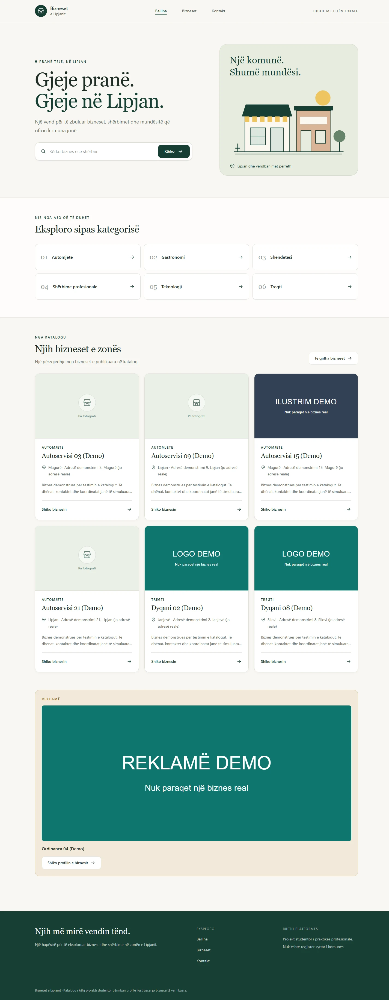
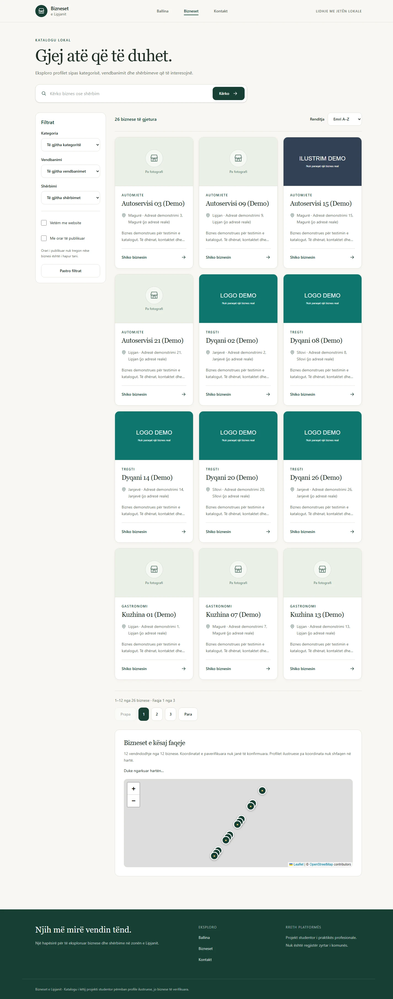
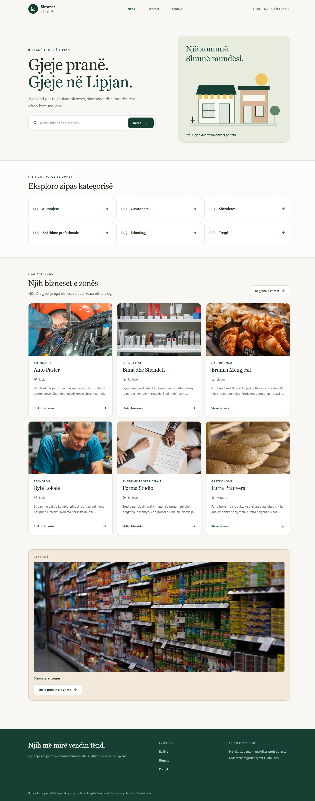
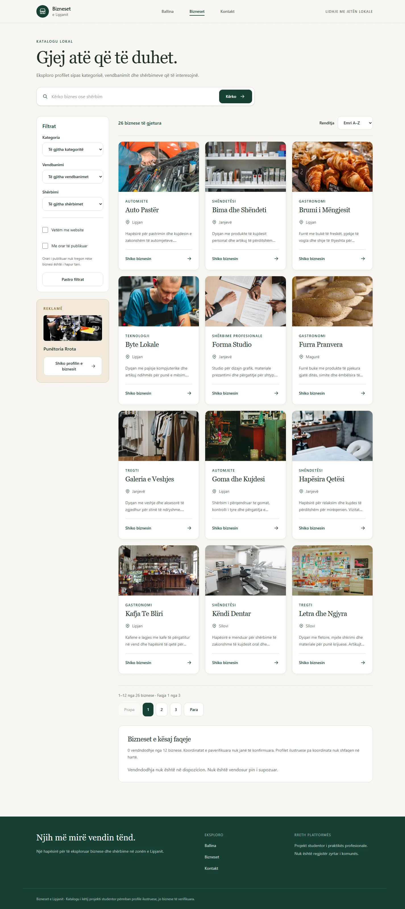
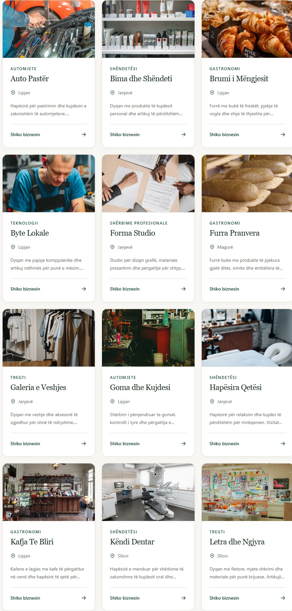
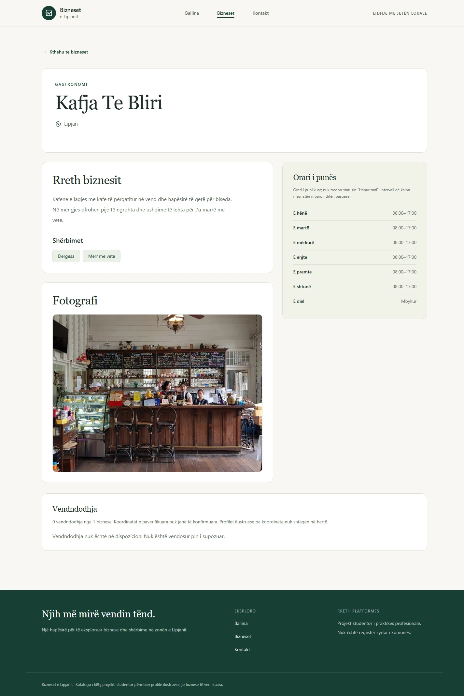
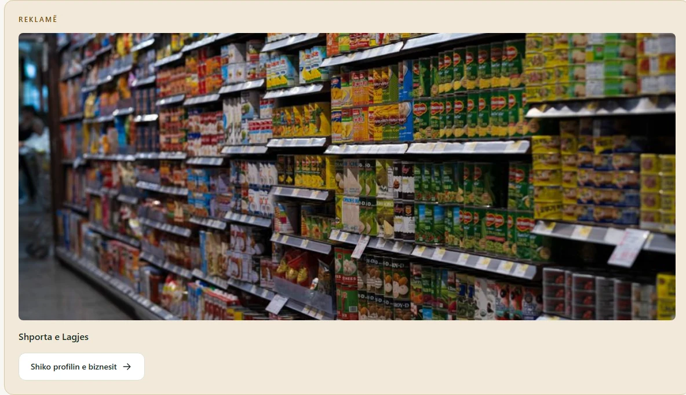

# Presentation content comparison

The before images use a restored copy of the development database taken before the seed refresh, served through the same frontend layout as the after images. They compare content, not the full previous UI implementation.

## Before

## After

Responsive captures: [390 px homepage](after-home-390.webp), [768 px homepage](after-home-768.webp), and [768 px directory](after-directory-768.webp).
